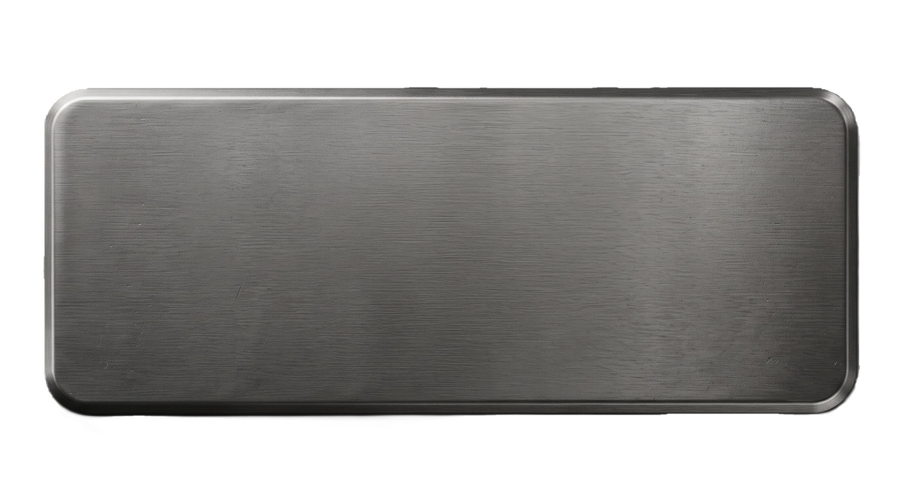

# Интерактивный тренажер щитка механика-водителя БМП-2

<p align="center">
  
</p>

Интерактивный программный комплекс на платформе **WPF (.NET 8)**, моделирующий контрольно-измерительные приборы, световую индикацию и органы управления на щитке приборов механика-водителя боевой машины пехоты **БМП-2**.

---

## 🎯 Назначение и возможности

Программа разработана в качестве учебно-демонстрационного тренажера для освоения алгоритмов взаимодействия с системами БМП-2:
- **Интерактивные приборы и датчики**:
  - Амперметр В-1 (контроль тока заряда/разряда АКБ);
  - Вольтметр / счетчик моточасов;
  - Тахометр ТЭ-45 (обороты коленчатого вала);
  - Спидометр со счетчиком пройденного пути;
  - Сдвоенный термометр ТУЭ-48 (температура охлаждающей жидкости и масла двигателя);
  - Манометры давления масла двигателя и давления в системе смазки КПП.
- **Органы управления с аутентичной логикой**:
  - Двухпозиционные тумблеры с переключением состояний;
  - Кнопки с защитными подпружиненными колпачками (блокировка случайного нажатия);
  - Поворотные регуляторы (кнобы/реостаты);
  - Тумблер ночной подсветки приборов и светомаскировки щитка.
- **Информационно-справочная система**:
  - Карточки тактико-технического описания узлов при клике на органы управления в режиме свободного ознакомления;
  - Реалистичная физика отклонения стрелок измерительных приборов со сглаживанием `BackEase`.
- **Режимы работы**:
  - Свободное ознакомление с элементами щитка;
  - Штатный пуск силовой установки;
  - Пуск двигателя с предварительной маслоподкачкой.

---

## 🛠 Стек технологий

- **Платформа**: .NET 8.0 (Windows)
- **UI Framework**: Windows Presentation Foundation (WPF, XAML)
- **Язык**: C# 12
- **Графика и стилизация**: векторные шейпы, растровые ассеты приборов и тумблеров, DropShadow-эффекты свечения ламп накаливания и подсветки шкал.

---

## 📂 Структура проекта

```text
bmp_2_panel/
├── bmp_2_panel.sln            # Решение Visual Studio
├── global.json                # Конфигурация SDK
├── .gitignore                 # Исключения бинарных и временных файлов
└── bmp_2_panel/
    ├── App.xaml / .cs         # Точка входа приложения
    ├── MainWindow.xaml / .cs  # Основной интерфейс щитка, контроллеры приборов и анимации
    ├── InfoCard.xaml / .cs    # Всплывающая карточка описания узла
    ├── AboutWindow.xaml / .cs # Модальное окно «О программе»
    └── assets/                # Графические ресурсы
        ├── background/        # Текстуры панели, винты и элементы корпуса
        ├── buttons/           # Тумблеры, кнопки, колпачки
        ├── designations/      # Трафареты и подписи органов управления
        ├── lights/            # Индикаторы и лампы накаливания
        └── sensors/           # Шкалы и стрелки контрольно-измерительных приборов
```

---

## 🚀 Сборка и запуск

### Требования
- ОС Windows 10 / 11;
- [.NET 8.0 SDK](https://dotnet.microsoft.com/download/dotnet/8.0) или новее;
- Visual Studio 2022 (с компонентом «Разработка классических приложений .NET») или Visual Studio Code / Rider.

### Быстрый старт через CLI:
```powershell
# Клонирование репозитория
git clone https://github.com/RaccoonKa/bmp_2_panel.git
cd bmp_2_panel

# Сборка и запуск
dotnet build
dotnet run --project bmp_2_panel/bmp_2_panel.csproj
```

---

## 👥 Авторы

- **Разработчик**: Кравчук Светозар Кириллович
- **Научный руководитель**: Рак Евгений Николаевич
